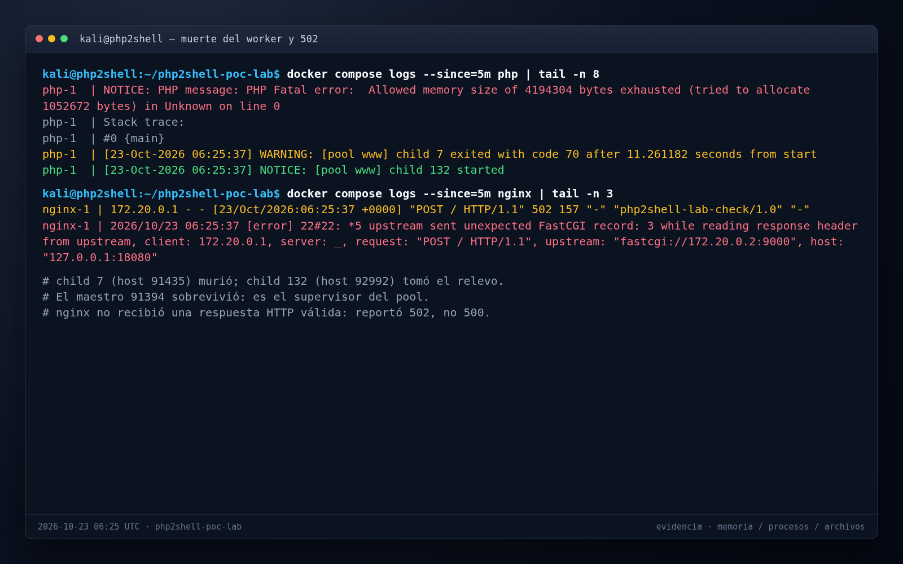

<div class="cover">

<div class="eyebrow">Actividad de sistemas operativos</div>

# PHP2Shell desde dentro

<div class="subtitle">Memoria, procesos y archivos en un OOM controlado</div>

<div class="rule"></div>

<table class="cover-meta">
<tr><td>Ejecución</td><td>23 de octubre de 2026, 02:25 (UTC-04)</td></tr>
<tr><td>Entorno</td><td>Kali Linux · Docker · PHP 8.5.11-FPM · nginx</td></tr>
<tr><td>Objetivo</td><td><code>http://127.0.0.1:18080/</code></td></tr>
<tr><td>Entregable</td><td>Este PDF</td></tr>
</table>

<p class="cover-note">El laboratorio reproduce un OOM de PHP y lo observa desde tres capas: memoria de usuario, procesos y sistemas de archivos. No incluye RCE ni heap grooming.</p>

<p class="cover-quote">“Si no está en la evidencia, es una opinión.”</p>

</div>

## 1. Propósito y entorno

El disparador es benigno: una petición con `session.upload_progress` y un cuerpo de 1 MiB. PHP alcanza su límite de memoria, el worker de FPM muere y nginx responde con un error. El objetivo es explicar qué pasó en cada capa y demostrarlo con evidencia real.

| Dato | Valor |
|---|---|
| Imagen | `php:8.5.11-fpm` |
| `memory_limit` | `4M` (4.194.304 bytes) |
| `memory.max` del cgroup | 268.435.456 bytes (256 MiB) |
| Pool FPM | `pm=static`, `pm.max_children=1` |
| Rootfs | solo lectura |
| `/tmp` | `tmpfs` de 64 MiB, `noexec`, `inode64` |
| Sesiones | `session.save_path=/tmp`, `cleanup=Off` |

La corrida completa se hace con un comando:

```bash
LAB_PORT=18080 ./lab/os-activity/run-activity.sh \
  --start --fresh \
  --url http://127.0.0.1:18080/
```

El flujo toma un snapshot inicial, valida el handler de sesión, traza el worker, dispara el OOM y guarda un snapshot final. Las evidencias quedan en `lab/os-activity/out/`; no se entregan.

## 2. Memoria: PHP se queda sin aire

| Métrica | Antes | Después |
|---|---:|---:|
| `memory.current` | 11.857.920 B (11,31 MiB) | 11.546.624 B (11,01 MiB) |
| `memory.peak` | 15.937.536 B (15,20 MiB) | 17.813.504 B (16,99 MiB) |
| `memory.max` | 268.435.456 B (256 MiB) | 268.435.456 B (256 MiB) |
| `memory.events` | `oom 0`, `oom_kill 0` | `oom 0`, `oom_kill 0` |
| `VmRSS` del worker | 15.776 kB | 11.188 kB |

Durante el muestreo, `memory.current` llegó a **13.418.496 B (12,80 MiB)**. El pico histórico subió a **16,99 MiB**, muy lejos de los 256 MiB del cgroup.

La clave es no mezclar contadores:

- `memory_limit` lo controla el **Zend Memory Manager** y cuenta solo las asignaciones de PHP.
- `VmRSS` es la memoria residente del proceso completo.
- `memory.current` es lo que el kernel le carga al cgroup.
- `memory.max` es el límite que activaría al OOM killer.

Como `memory.events` tiene `oom 0`, el kernel no mató nada. El que se quedó sin memoria fue PHP.


## 3. Traza: la secuencia exacta

```text
7  06:25:36.781971 read(5<TCPv6:[342562]>, "------php2shellLabBoundary ... name=\"PHPSESSID\" ...", 5120) = 5120
7  06:25:37.827806 mmap(NULL, 2097152, PROT_READ|PROT_WRITE, MAP_PRIVATE|MAP_ANONYMOUS, -1, 0) = 0x7fe14c000000
7  06:25:37.830076 write(2<pipe:[340030]>, "NOTICE: PHP message: PHP Fatal error:  Allowed memory size of 4194304 bytes exhausted (tried to allocate 1052672 bytes) in Unknown on line 0\nStack trace:\n#0 {main}\n", 164) = 164
7  06:25:37.849131 exit_group(70)    = ?
```

La traza muestra la historia completa:

1. El worker lee el cuerpo multipart de la petición.
2. Zend MM pide un bloque de 2 MiB.
3. El siguiente intento de 1.052.672 bytes ya no cabe en los 4 MiB.
4. PHP escribe el fatal y termina con `exit_group(70)`.

`exit_group(70)` es una salida normal del proceso, no un `SIGKILL`. Si el kernel hubiera intervenido, se vería en `memory.events` y en la traza.


## 4. Procesos: muere el worker, no el maestro

| Dato | Antes | Después |
|---|---|---|
| Maestro FPM (host) | 91394 | 91394 |
| Worker FPM (host) | 91435 | 92992 |
| Worker FPM (contenedor) | 7 | 132 |
| Usuario del worker | `www-data` | `www-data` |

```text
php-1  | NOTICE: PHP message: PHP Fatal error:  Allowed memory size of 4194304 bytes exhausted (tried to allocate 1052672 bytes) in Unknown on line 0
php-1  | WARNING: [pool www] child 7 exited with code 70 after 11.261182 seconds from start
php-1  | NOTICE: [pool www] child 132 started

nginx-1 | "POST / HTTP/1.1" 502 157
nginx-1 | upstream sent unexpected FastCGI record: 3 while reading response header from upstream
```

El **maestro** sobrevive porque es el supervisor del pool. El **worker** muere con `exit code 70` y FPM crea el hijo 132. nginx responde **502** porque el upstream FastCGI se rompió, no porque la aplicación haya devuelto un 500.



## 5. Archivos: lo que quedó escrito

| Ruta | Tipo | Opciones | Escritura |
|---|---|---|---|
| `/tmp` | `tmpfs` | `rw,nosuid,nodev,noexec,size=65536k,inode64` | sí |
| `/var/www/html` | `ext4` | `ro,relatime,errors=remount-ro` | no |

La sesión sobrevive a la muerte del worker porque vive en `/tmp`, no en la memoria del proceso:

```text
inodo=3  modo=600  propietario=www-data:www-data  tamaño=362
ruta=/tmp/sess_97cc4566e2540eb35ca39409c24fafba
```

El rootfs es de solo lectura; un `touch` allí falla con `Read-only file system`. `/tmp` sí es escribible porque es un `tmpfs` separado.

`noexec` impide ejecutar un archivo con `execve`, pero no impide leerlo o interpretarlo. Esta actividad no explota esa diferencia: solo la documenta.


## 6. Línea de tiempo y conclusiones

| Hora (UTC) | Evento | Evidencia |
|---|---|---|
| 06:25:36.782 | El worker lee el multipart | `read(5...) = 5120` |
| 06:25:37.827 | Zend MM pide 2 MiB | `mmap(NULL, 2097152, ...)` |
| 06:25:37.830 | Fatal por `memory_limit` | `4194304 bytes exhausted` |
| 06:25:37.849 | El worker termina | `exit_group(70)` |
| 06:25:37 | FPM reemplaza el worker | `child 132 started` |
| 06:25:37 | nginx ve el corte | `502` |
| 06:25:39 | Snapshot final | `sess_*` en `/tmp` |

**Conclusiones:**

1. El fallo es un **OOM de PHP**, no del kernel: `memory.events` tiene `oom 0` y `oom_kill 0`.
2. El que muere es el **worker**; el maestro sobrevive y lo reemplaza. `exit code 70` es un estado de salida, no una señal.
3. La sesión queda en un `tmpfs` con modo `600`, y nginx responde **502** porque el upstream FastCGI se cortó.

La métrica que cierra el caso:

```text
memory.current : 11.546.624 B  (11,01 MiB)
memory.peak    : 17.813.504 B  (16,99 MiB)
memory.max     : 268.435.456 B (256,00 MiB)
memory.events  : oom 0, oom_kill 0
```

## 7. Reproducir y entregar

```bash
# Iniciar el stack
docker compose up -d php nginx

# Corrida completa
LAB_PORT=18080 ./lab/os-activity/run-activity.sh \
  --start --fresh \
  --url http://127.0.0.1:18080/

# Revisar el resumen
cat lab/os-activity/out/latest/summary.md

# Limpiar
docker compose down -v
```

Si no quieres usar `strace`, ejecuta el flujo con `--no-trace`. La evidencia de memoria y procesos sigue saliendo de `/proc`, del cgroup y de los logs.

El **único entregable es este PDF**. No se entrega el directorio `out/`, ni capturas sueltas, ni archivos Markdown. La guía corta de la actividad está en `lab/os-activity/README.md`.

Si repites el laboratorio y quieres regenerar el PDF, actualiza los datos en `informe.md` y ejecuta:

```bash
cd lab/os-activity/entrega
./generar-pdf.sh
```
